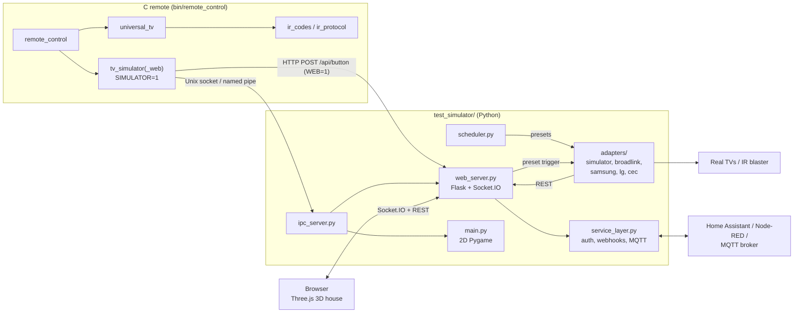

# Smart Home RC Simulator

A C universal TV remote paired with a browser-based 3D smart-home simulator.

- **C remote** (`include/`, `src/`): multi-protocol IR encoding (NEC, RC5, RC6, Sony SIRC), a
  universal-TV code database with multi-protocol and scan modes, event handlers, connection and
  latency instrumentation. Transmission is simulated on a PC; the hardware layer is yours to port.
- **3D simulator** (`test_simulator/`): a Flask + Socket.IO server and a Three.js scene of a full
  house whose TV, lights and smart devices respond to remote buttons. There is also a 2D Pygame
  version.
- **Automation:** a REST/WebSocket API, a time-based scheduler with presets, optional API key,
  webhooks and MQTT, and adapters for Broadlink, Samsung, LG and HDMI-CEC devices.

Everything runs locally. Brand detection and IR protocol classification are rule-based; there are
no ML models or cloud APIs ([audit](docs/ML_CV_AI_AUDIT.md)).

## Quick start

### C remote (about 1 minute)

Needs `gcc` (or `clang`) and GNU `make` (MinGW/MSYS2 on Windows).

```bash
make                  # builds bin/remote_control
make examples         # builds bin/*_example and bin/latency_probe
make test             # C unit tests
./bin/remote_control  # interactive demo menu
```

### Web simulator (about 5 minutes)

Needs Python 3.10+.

```bash
cd test_simulator
python3 -m venv .venv && source .venv/bin/activate   # Windows: .venv\Scripts\activate
pip install -r requirements.txt
python web_server.py
```

Open <http://localhost:5000>. Click the 3D remote, or press `P` for power. From another terminal:

```bash
curl -X POST http://localhost:5000/api/button -H "Content-Type: application/json" -d '{"button_code":16}'
curl http://localhost:5000/api/state
```

Poetry works too: `poetry install && poetry run web-server`. More options (desktop simulator,
connecting the C remote, the scheduler, troubleshooting): [docs/GETTING_STARTED.md](docs/GETTING_STARTED.md).

## Architecture



## Repository layout

```
include/, src/        C remote library and demo (src/main.c)
examples/             Example programs (built by `make examples`)
docs/                 Documentation (index: docs/README.md)
test_simulator/       Python web/desktop simulators, scheduler, adapters, tests
  web_static/, web_templates/   Three.js front end
  adapters/           Device backends
  gpu_runtime/        GPU detection and graphics presets
  tests/              pytest suite
scripts/check_links.py  Markdown link checker
Makefile
```

## Documentation

| | |
|-|-|
| **Start here** | [Getting started](docs/GETTING_STARTED.md) · [Documentation index](docs/README.md) |
| **Simulator** | [Features and controls](test_simulator/FEATURES.md) · [API](test_simulator/API.md) · [Overview](test_simulator/README.md) |
| **Automation** | [Service, adapters, scheduler](test_simulator/docs/SERVICE_AND_AUTOMATION.md) · [Home Assistant / Node-RED](test_simulator/docs/HOME_ASSISTANT_NODE_RED.md) · [Production](test_simulator/PRODUCTION.md) |
| **C remote** | [C remote](docs/C_REMOTE.md) · [Buttons](docs/BUTTONS.md) · [Handlers](docs/HANDLERS.md) · [Connection](docs/CONNECTION.md) · [I/O mode](docs/IO_MODE.md) · [System handler](docs/SYSTEM_HANDLER.md) · [Latency](docs/LATENCY.md) · [Assembly](docs/ASSEMBLY_INTEGRATION.md) |
| **Project** | [Contributing](CONTRIBUTING.md) · [Testing](test_simulator/TESTING.md) · [Changelog](CHANGELOG.md) · [Roadmap](ROADMAP.md) |

## License

Apache License 2.0. See [LICENSE](LICENSE).
